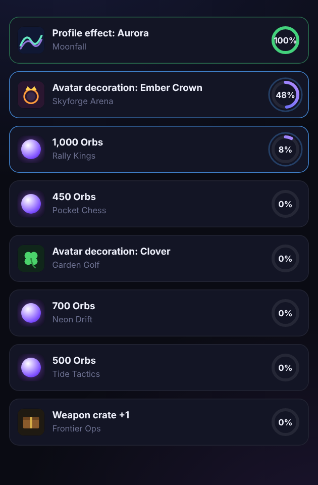

<p align="center"></p>
<h1 align="center">Orbek – Discord Quests &amp; Orbs</h1>
<p align="center">Orbek shows all Discord quests – for Orbs, Discord cosmetics and in-game rewards – sorted the way you want, with progress you can watch live. It installs everything it needs in Discord with one click.</p>
<p align="center"><a href="README.md" title="English"></a> <a href="docs/readme/README.pl.md" title="Polski"></a> <a href="docs/readme/README.de.md" title="Deutsch"></a> <a href="docs/readme/README.fr.md" title="Français"></a> <a href="docs/readme/README.es.md" title="Español"></a> <a href="docs/readme/README.it.md" title="Italiano"></a> <a href="docs/readme/README.pt.md" title="Português (BR)"></a> <a href="docs/readme/README.ru.md" title="Русский"></a> <a href="docs/readme/README.uk.md" title="Українська"></a> <a href="docs/readme/README.tr.md" title="Türkçe"></a> <a href="docs/readme/README.ja.md" title="日本語"></a> <a href="docs/readme/README.zh.md" title="简体中文"></a></p>
<p align="center">
  <a href="https://github.com/Yasaiek/Orbek-Discord-Quests-Orbs/releases/latest/download/Orbek.exe"><b>⬇ Download for Windows</b></a> &nbsp;·&nbsp;
  <a href="https://yasaiek.github.io/Orbek-Discord-Quests-Orbs/"><b>🌐 Website</b></a> &nbsp;·&nbsp;
  <a href="CHANGELOG.md">Changelog</a> &nbsp;·&nbsp;
  <a href="https://github.com/Yasaiek/Orbek-Discord-Quests-Orbs/issues/new">Report a bug</a>
</p>
<p align="center"></p>
<table align="center"><tr>
<td align="center" valign="top"></td>
<td align="center" valign="top"></td>
<td align="center" valign="top"></td>
</tr></table>

## What it does

- **All quests in one place** – Games, videos and activities in tabs, with the time left and live progress rings.
- **Rewards at a glance** – Orbs, avatar decorations, profile effects, in-game items – see what a quest gives before you start it.
- **Sorting and filters** – Ending soonest, most Orbs, shortest or newest; Discord cosmetics only; a compact mini view and a small window.
- **One-click setup** – Orbek downloads Vencord, adds its plugin, builds it and hooks it into Discord. Nothing to install by hand.
- **Optional automation** – Let Orbek do quests by itself, several at once. Off by default – Discord forbids it, so it is at your own risk.
- **Updates itself** – New versions come from GitHub releases, checked against their SHA-256. 12 languages.

## Tutorial

1. **Download and run Orbek** – Download Orbek.exe from the project page, put it in a folder of its own and run it. Its icon appears next to the clock.
2. **Click “Install everything”** – On the Setup tab Orbek downloads Node.js and Vencord, puts the plugin in, builds it and hooks it into Discord. It takes a few minutes.
3. **Discord restarts by itself** – After the setup Discord starts again with the Orbek plugin. “Discord connected” turns green at the bottom of the window.
4. **Browse the quests** – Games, Videos and For Orbs tabs, sorting and a cosmetics filter. Every quest shows its rewards, progress and time left.
5. **Accept and claim** – “Accept quest” takes the quest. When it's done, click “Claim one by one in Discord” – Discord shows the rewards one after another and you only solve a captcha when one appears.
6. **Automation – at your own risk** – In Settings you can let Orbek do quests by itself, several at once. Discord forbids this and may take the rewards back or ban the account.
7. **Mini view** – Switch the view to “Mini” or open “Small window” to see just the rewards and progress rings.
8. **Updates** – Orbek updates itself from GitHub. When a newer plugin is out you will see an “Update plugin” bar.

## Questions

**Is it allowed?**  
Browsing and accepting quests is exactly what Discord does itself. Doing them automatically breaks Discord's rules – it may take the rewards back or ban the account.

**Does Orbek see my Discord password or token?**  
No. Everything goes through a plugin inside your own Discord app. Orbek only gets the quest list from it; your token never leaves Discord.

**What is Vencord?**  
A popular mod for the Discord desktop app. Orbek's plugin runs in it; the setup installs it for you.

**Windows warns about an unknown publisher.**  
The file is not code-signed. The source is public and every release is built from it by GitHub Actions.

## Build from source

Go 1.24 or newer:

```
go build -trimpath -ldflags "-H=windowsgui -s -w" -o Orbek.exe .
```

## Disclaimer

Doing Discord quests automatically is against Discord's rules. Orbek is not affiliated with Discord. You use it at your own risk.
