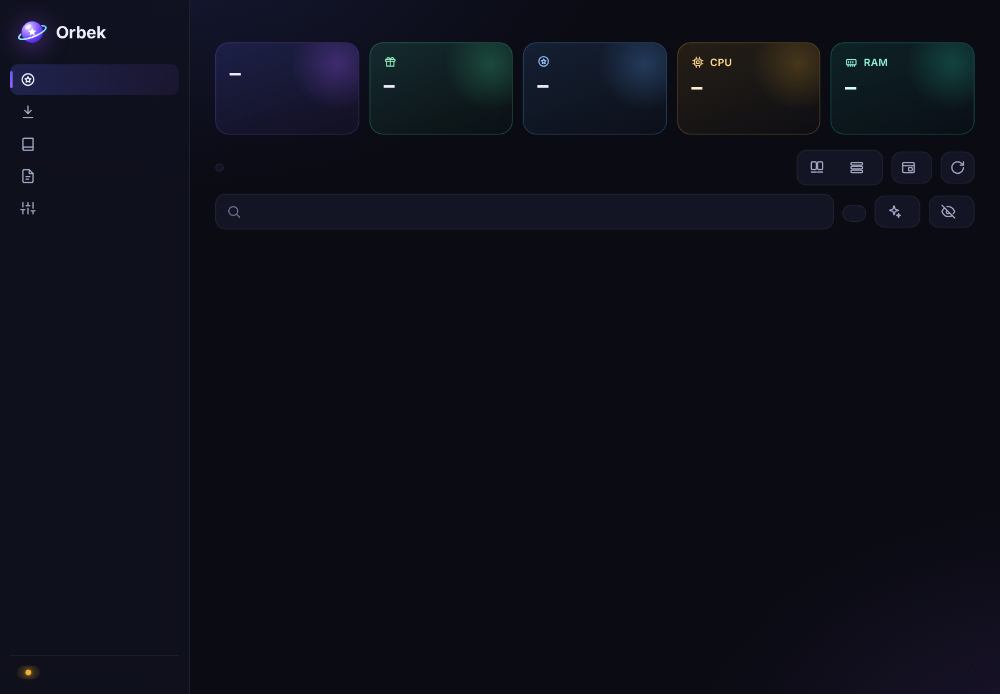

<p align="center"></p>
<h1 align="center">Orbek – Discord Quests &amp; Orbs</h1>
<p align="center">Orbek affiche toutes les quêtes Discord – pour des Orbs, des cosmétiques Discord et des récompenses en jeu – triées comme tu veux, avec la progression en direct. Il installe tout ce qu'il lui faut dans Discord en un clic.</p>
<p align="center"><a href="../../README.md" title="English"></a> <a href="../../docs/readme/README.pl.md" title="Polski"></a> <a href="../../docs/readme/README.de.md" title="Deutsch"></a> <a href="../../docs/readme/README.fr.md" title="Français"></a> <a href="../../docs/readme/README.es.md" title="Español"></a> <a href="../../docs/readme/README.it.md" title="Italiano"></a> <a href="../../docs/readme/README.pt.md" title="Português (BR)"></a> <a href="../../docs/readme/README.ru.md" title="Русский"></a> <a href="../../docs/readme/README.uk.md" title="Українська"></a> <a href="../../docs/readme/README.tr.md" title="Türkçe"></a> <a href="../../docs/readme/README.ja.md" title="日本語"></a> <a href="../../docs/readme/README.zh.md" title="简体中文"></a></p>
<p align="center">
  <a href="https://github.com/Yasaiek/Orbek-Discord-Quests-Orbs/releases/latest/download/Orbek.exe"><b>⬇ Télécharger pour Windows</b></a> &nbsp;·&nbsp;
  <a href="https://yasaiek.github.io/Orbek-Discord-Quests-Orbs/"><b>🌐 Site</b></a> &nbsp;·&nbsp;
  <a href="../../CHANGELOG.md">Changements</a> &nbsp;·&nbsp;
  <a href="https://github.com/Yasaiek/Orbek-Discord-Quests-Orbs/issues/new">Signaler un bug</a>
</p>
<p align="center"></p>
<table align="center"><tr>
<td align="center" valign="top"></td>
<td align="center" valign="top"></td>
<td align="center" valign="top"></td>
</tr></table>

## Ce qu'il fait

- **Toutes les quêtes au même endroit** – Jeux, vidéos et activités par onglets, avec le temps restant et des anneaux de progression en direct.
- **Les récompenses d'un coup d'œil** – Orbs, décorations d'avatar, effets de profil, objets en jeu – vois ce que donne une quête avant de la commencer.
- **Tri et filtres** – Finissent bientôt, le plus d'Orbs, les plus courtes ou les plus récentes ; cosmétiques Discord seulement ; vue mini et petite fenêtre.
- **Installation en un clic** – Orbek télécharge Vencord, ajoute son plugin, le compile et le branche sur Discord. Rien à installer à la main.
- **Automatisation au choix** – Orbek peut faire les quêtes tout seul, plusieurs à la fois. Désactivée par défaut – Discord l'interdit, donc à tes risques.
- **Se met à jour tout seul** – Les nouvelles versions viennent des releases GitHub, vérifiées par SHA-256. 12 langues.

## Tutoriel

1. **Télécharge et lance Orbek** – Télécharge Orbek.exe depuis la page du projet, mets-le dans un dossier à part et lance-le. Son icône apparaît près de l'horloge.
2. **Clique sur « Tout installer »** – Dans l'onglet Installation, Orbek télécharge Node.js et Vencord, y met le plugin, le compile et le branche sur Discord. Ça prend quelques minutes.
3. **Discord redémarre tout seul** – Après l'installation, Discord redémarre avec le plugin Orbek. « Discord connecté » passe au vert en bas de la fenêtre.
4. **Parcours les quêtes** – Onglets Jeux, Vidéos et Pour des Orbs, tri et filtre des cosmétiques. Chaque quête montre ses récompenses, sa progression et le temps restant.
5. **Accepter et récupérer** – « Accepter la quête » la prend. Une fois faite, clique « Récupérer une par une dans Discord » – Discord montre les récompenses l'une après l'autre, tu ne résous qu'un captcha s'il apparaît.
6. **Automatisation – à tes risques** – Dans les Paramètres, tu peux laisser Orbek faire les quêtes tout seul, plusieurs à la fois. Discord l'interdit et peut reprendre les récompenses ou bannir le compte.
7. **Vue mini** – Passe la vue en « Mini » ou ouvre « Petite fenêtre » pour ne voir que les récompenses et les anneaux de progression.
8. **Mises à jour** – Orbek se met à jour tout seul depuis GitHub. Quand un plugin plus récent sort, une barre « Mettre à jour le plugin » apparaît.

## Questions

**Est-ce autorisé ?**  
Parcourir et accepter des quêtes, c'est exactement ce que fait Discord. Les faire automatiquement enfreint ses règles – il peut reprendre les récompenses ou bannir le compte.

**Orbek voit-il mon mot de passe ou mon token Discord ?**  
Non. Tout passe par un plugin dans ta propre appli Discord. Orbek ne reçoit que la liste des quêtes ; ton token ne quitte jamais Discord.

**Qu'est-ce que Vencord ?**  
Un mod populaire pour l'appli Discord sur ordinateur. Le plugin d'Orbek tourne dedans ; l'installation le met en place pour toi.

**Windows avertit d'un éditeur inconnu.**  
Le fichier n'est pas signé. Le code est public et chaque release est compilée à partir de lui par GitHub Actions.

## Compiler depuis les sources

Go 1.24 ou plus récent :

```
go build -trimpath -ldflags "-H=windowsgui -s -w" -o Orbek.exe .
```

## Avertissement

Faire les quêtes Discord automatiquement enfreint les règles de Discord. Orbek n'est pas affilié à Discord. Tu l'utilises à tes risques.
