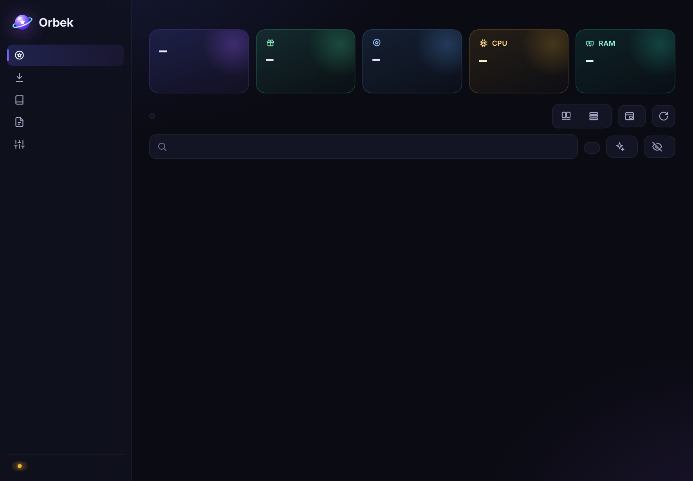

<p align="center"></p>
<h1 align="center">Orbek – Discord Quests &amp; Orbs</h1>
<p align="center">Orbek tüm Discord görevlerini – Orbs, Discord kozmetiği ve oyun içi ödüller için – istediğin gibi sıralanmış ve canlı ilerlemeyle gösterir. Discord'da ihtiyaç duyduğu her şeyi tek tıkla kurar.</p>
<p align="center"><a href="../../README.md" title="English"></a> <a href="../../docs/readme/README.pl.md" title="Polski"></a> <a href="../../docs/readme/README.de.md" title="Deutsch"></a> <a href="../../docs/readme/README.fr.md" title="Français"></a> <a href="../../docs/readme/README.es.md" title="Español"></a> <a href="../../docs/readme/README.it.md" title="Italiano"></a> <a href="../../docs/readme/README.pt.md" title="Português (BR)"></a> <a href="../../docs/readme/README.ru.md" title="Русский"></a> <a href="../../docs/readme/README.uk.md" title="Українська"></a> <a href="../../docs/readme/README.tr.md" title="Türkçe"></a> <a href="../../docs/readme/README.ja.md" title="日本語"></a> <a href="../../docs/readme/README.zh.md" title="简体中文"></a></p>
<p align="center">
  <a href="https://github.com/Yasaiek/Orbek-Discord-Quests-Orbs/releases/latest/download/Orbek.exe"><b>⬇ Windows için indir</b></a> &nbsp;·&nbsp;
  <a href="https://yasaiek.github.io/Orbek-Discord-Quests-Orbs/"><b>🌐 Site</b></a> &nbsp;·&nbsp;
  <a href="../../CHANGELOG.md">Değişiklikler</a> &nbsp;·&nbsp;
  <a href="https://github.com/Yasaiek/Orbek-Discord-Quests-Orbs/issues/new">Hata bildir</a>
</p>
<p align="center"></p>
<table align="center"><tr>
<td align="center" valign="top"></td>
<td align="center" valign="top"></td>
<td align="center" valign="top"></td>
</tr></table>

## Ne yapar

- **Tüm görevler tek yerde** – Oyunlar, videolar ve etkinlikler sekmelerde; kalan süre ve canlı ilerleme halkalarıyla.
- **Ödüller bir bakışta** – Orbs, avatar süsleri, profil efektleri, oyun içi eşyalar – bir görevin ne verdiğini başlamadan gör.
- **Sıralama ve filtreler** – En erken bitenler, en çok Orbs, en kısalar ya da en yeniler; yalnızca Discord kozmetiği; mini görünüm ve küçük pencere.
- **Tek tıkla kurulum** – Orbek Vencord'u indirir, eklentisini ekler, derler ve Discord'a bağlar. Elle kurulacak bir şey yok.
- **İsteğe bağlı otomasyon** – Orbek görevleri kendisi, birkaçını aynı anda yapabilir. Varsayılan olarak kapalı – Discord bunu yasaklar, risk sana ait.
- **Kendini günceller** – Yeni sürümler GitHub sürümlerinden gelir ve SHA-256 ile doğrulanır. 12 dil.

## Rehber

1. **Orbek'i indir ve çalıştır** – Orbek.exe'yi proje sayfasından indir, ayrı bir klasöre koy ve çalıştır. Simgesi saatin yanında belirir.
2. **“Her şeyi kur”a tıkla** – Kurulum sekmesinde Orbek, Node.js ve Vencord'u indirir, eklentiyi koyar, derler ve Discord'a bağlar. Birkaç dakika sürer.
3. **Discord kendiliğinden yeniden başlar** – Kurulumdan sonra Discord, Orbek eklentisiyle yeniden açılır. Pencerenin altında “Discord bağlı” yeşile döner.
4. **Görevlere göz at** – Oyunlar, Videolar ve Orbs için sekmeleri, sıralama ve kozmetik filtresi. Her görev ödüllerini, ilerlemesini ve kalan süresini gösterir.
5. **Kabul et ve al** – “Görevi kabul et” görevi alır. Bitince “Discord'da tek tek al”a tıkla – Discord ödülleri sırayla gösterir, sen yalnızca çıkarsa captcha'yı çözersin.
6. **Otomasyon – risk sana ait** – Ayarlar'da Orbek'in görevleri kendisi, birkaçını aynı anda yapmasına izin verebilirsin. Discord bunu yasaklar ve ödülleri geri alabilir ya da hesabı yasaklayabilir.
7. **Mini görünüm** – Yalnızca ödülleri ve ilerleme halkalarını görmek için görünümü “Mini”ye al ya da “Küçük pencere”yi aç.
8. **Güncellemeler** – Orbek kendini GitHub'dan günceller. Daha yeni bir eklenti çıktığında “Eklentiyi güncelle” çubuğu görünür.

## Sorular

**Buna izin var mı?**  
Görevlere göz atmak ve kabul etmek Discord'un kendisinin yaptığı şeydir. Onları otomatik yapmak kurallarına aykırıdır – ödülleri geri alabilir ya da hesabı yasaklayabilir.

**Orbek Discord şifremi ya da token'ımı görüyor mu?**  
Hayır. Her şey kendi Discord uygulamandaki bir eklentiden geçer. Orbek ondan yalnızca görev listesini alır; token'ın Discord'dan hiç çıkmaz.

**Vencord nedir?**  
Bilgisayardaki Discord uygulaması için popüler bir mod. Orbek'in eklentisi onun içinde çalışır; kurulum onu senin için kurar.

**Windows bilinmeyen yayıncı uyarısı veriyor.**  
Dosya imzalı değil. Kaynak kod açık ve her sürüm GitHub Actions tarafından ondan derlenir.

## Kaynaktan derleme

Go 1.24 veya daha yeni:

```
go build -trimpath -ldflags "-H=windowsgui -s -w" -o Orbek.exe .
```

## Sorumluluk reddi

Discord görevlerini otomatik yapmak Discord'un kurallarına aykırıdır. Orbek'in Discord ile bağlantısı yoktur. Kullanım riski sana aittir.
