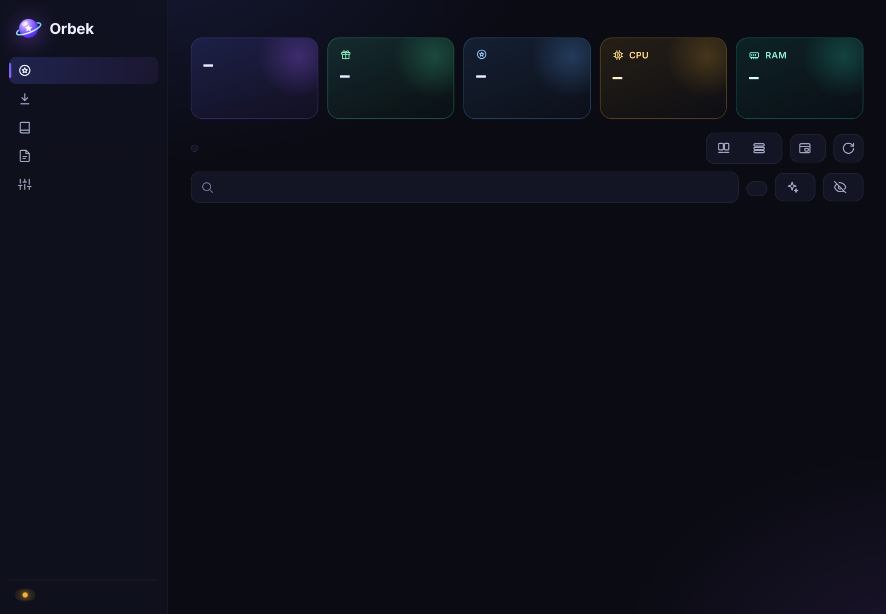

<p align="center"></p>
<h1 align="center">Orbek – Discord Quests &amp; Orbs</h1>
<p align="center">Orbek 显示所有 Discord 任务——可获得 Orbs、Discord 装饰和游戏内奖励——按你喜欢的方式排序，并实时显示进度。它在 Discord 中需要的一切都能一键安装。</p>
<p align="center"><a href="../../README.md" title="English"></a> <a href="../../docs/readme/README.pl.md" title="Polski"></a> <a href="../../docs/readme/README.de.md" title="Deutsch"></a> <a href="../../docs/readme/README.fr.md" title="Français"></a> <a href="../../docs/readme/README.es.md" title="Español"></a> <a href="../../docs/readme/README.it.md" title="Italiano"></a> <a href="../../docs/readme/README.pt.md" title="Português (BR)"></a> <a href="../../docs/readme/README.ru.md" title="Русский"></a> <a href="../../docs/readme/README.uk.md" title="Українська"></a> <a href="../../docs/readme/README.tr.md" title="Türkçe"></a> <a href="../../docs/readme/README.ja.md" title="日本語"></a> <a href="../../docs/readme/README.zh.md" title="简体中文"></a></p>
<p align="center">
  <a href="https://github.com/Yasaiek/Orbek-Discord-Quests-Orbs/releases/latest/download/Orbek.exe"><b>⬇ 下载 Windows 版</b></a> &nbsp;·&nbsp;
  <a href="https://yasaiek.github.io/Orbek-Discord-Quests-Orbs/"><b>🌐 网站</b></a> &nbsp;·&nbsp;
  <a href="../../CHANGELOG.md">更新日志</a> &nbsp;·&nbsp;
  <a href="https://github.com/Yasaiek/Orbek-Discord-Quests-Orbs/issues/new">报告问题</a>
</p>
<p align="center"></p>
<table align="center"><tr>
<td align="center" valign="top"></td>
<td align="center" valign="top"></td>
<td align="center" valign="top"></td>
</tr></table>

## 功能

- **所有任务集中一处** – 游戏、视频和活动分页显示，附带剩余时间和实时进度环。
- **奖励一目了然** – Orbs、头像装饰、个人资料特效、游戏内物品——开始前就能看到任务给什么。
- **排序和筛选** – 最早结束、Orbs 最多、最短或最新；仅限 Discord 装饰；迷你视图和小窗口。
- **一键安装** – Orbek 会下载 Vencord、加入插件、构建并接入 Discord。无需手动安装任何东西。
- **可选的自动化** – Orbek 可以自动完成任务，还能多个同时进行。默认关闭——Discord 禁止这样做，风险自负。
- **自动更新** – 新版本来自 GitHub 发布，并用 SHA-256 校验。支持 12 种语言。

## 教程

1. **下载并运行 Orbek** – 从项目页面下载 Orbek.exe，放进单独的文件夹并运行。图标会出现在时钟旁边。
2. **点击“全部安装”** – 在安装页，Orbek 会下载 Node.js 和 Vencord、放入插件、构建并接入 Discord。需要几分钟。
3. **Discord 会自动重启** – 安装后 Discord 会带着 Orbek 插件重新启动。窗口底部的“Discord 已连接”会变成绿色。
4. **浏览任务** – 游戏、视频和 Orbs 奖励页签、排序以及装饰筛选。每个任务都会显示奖励、进度和剩余时间。
5. **接受并领取** – “接受任务”会接下任务。完成后点击“在 Discord 中逐个领取”——Discord 会逐个显示奖励，只有出现验证码时你才需要完成它。
6. **自动化——风险自负** – 在设置中可以让 Orbek 自动完成任务，并可多个同时进行。Discord 禁止这样做，可能收回奖励或封禁账户。
7. **迷你视图** – 把视图切换为“迷你”或打开“小窗口”，只看奖励和进度环。
8. **更新** – Orbek 会从 GitHub 自动更新。有更新的插件时会出现“更新插件”提示条。

## 常见问题

**这样做允许吗？**  
浏览和接受任务正是 Discord 自己做的事。自动完成任务违反 Discord 规则——可能收回奖励或封禁账户。

**Orbek 会看到我的 Discord 密码或令牌吗？**  
不会。一切都通过你自己 Discord 应用里的插件进行。Orbek 只从插件获得任务列表；你的令牌从不离开 Discord。

**Vencord 是什么？**  
一个流行的 Discord 电脑版模组。Orbek 的插件在其中运行；安装程序会替你装好。

**Windows 提示未知发布者。**  
该文件没有代码签名。源代码是公开的，每个发布版本都由 GitHub Actions 从源码构建。

## 从源码构建

Go 1.24 或更新版本：

```
go build -trimpath -ldflags "-H=windowsgui -s -w" -o Orbek.exe .
```

## 免责声明

自动完成 Discord 任务违反 Discord 规则。Orbek 与 Discord 无关。使用风险自负。
